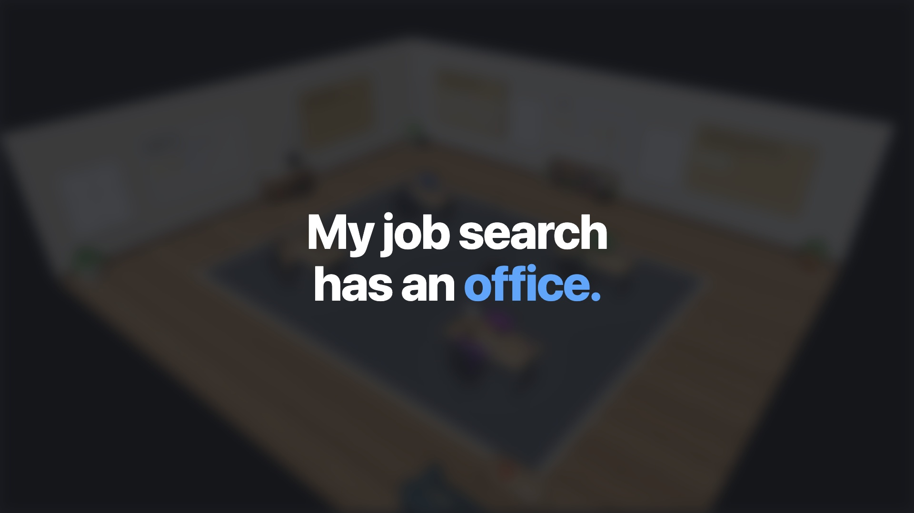

# AI Career Office

A 3D office (three.js) where AI agents help me move into an AI Engineer role through LinkedIn:
a content strategist, a profile optimizer, a job and people scout, and a career coach.
Each agent is a worker at a desk. Click one to chat.

[](brag-output/brag.mp4)

*Click the image to watch the demo video ([brag-output/brag.mp4](brag-output/brag.mp4)).*

- **Backend:** Python, FastAPI, Claude Agent SDK (runs on a Claude plan through the Claude Code login, no API key)
- **Frontend:** Vite, TypeScript, three.js
- **Status:** in progress. Nora, the content strategist, works end to end: she reads my project folders (read-only, secrets blocked and redacted), searches the web, and writes a weekly LinkedIn brief.

## Run

```bash
cd backend && uv run uvicorn app.main:app --port 8000
cd frontend && npm run dev   # http://localhost:5173
```

## 3D assets

The office and the four workers are built in Blender from Python scripts, so they can be edited and rebuilt:

- `assets/office/build_office.py`: four department offices off a central corridor (Content Studio, Profile Lab,
  Scouting Desk, Coaching Room), each with a glass front, sign, accent colour, workstation and themed props
  (laid out to match `frontend/src/office.ts` and the board positions in `frontend/src/main.ts`)
- `assets/characters/<name>.py`: Nora, Leo, Maya, Kai, using the shared toolkit in `assets/characters/toolkit.py`
  (metaball bodies, sculpted heads, clothing layers, one humanoid skeleton so the web app can seat and animate them)

```bash
assets/build_all.sh   # writes frontend/public/models/*.glb (Draco-compressed)
```

See `tasks/plan.md` for the roadmap.
